<div align="center">


# QuietSpot
### *"Find your focus, skip the crowd."*
**Real-Time Study Area Tracker and Finder in Batangas City**


[Features](#-project-features) • [OOP Principles](#-oop-principles-applied) • [Architecture & UML](#-project-structure--uml-class-diagram) • [Run Locally](#-how-to-run-the-program) • [Screenshots & Output](#-sample-screenshots-output--highlights) • [Team](#-team-members)

</div>

---

## 🎯 Project Overview
**QuietSpot** is a Java-powered full-stack web application designed to help students, faculty, and staff of **Batangas State University – The National Engineering University (Alangilan Campus)** and nearby Batangas City study hubs locate conducive study spots in real time. Instead of walking from one packed café or library to another, users can check live crowd levels, noise conditions, available amenities, pricing, and usual busy hours in one centralized platform—while contributing live community updates and earning rewards.

> [!IMPORTANT]
> **The Problem We Solve:** During regular class days and exam weeks, finding a quiet seat with reliable Wi-Fi and power outlets is a guessing game. Existing map apps only show static addresses—not whether a spot is currently noisy or full.
>
> **Why OOP?** Modeling the domain with Object-Oriented Programming lets different venue types (`Cafe`, `Library`, `StudyRoom`, `CoworkingSpace`), user accounts (`UserAccount` & `UserProfile`), amenities (`Facility`), storage backends (`UserStorage` & `SpotStorage`), and live reports (`ReportStatus`) interact cleanly. Using an `abstract` parent class (`SpotArea`) makes the system easy to scale, while custom exceptions (`InvalidInputException`) keep data valid and secure.

---

## ✨ Project Features
- 📍 **Location-Based Discovery & Interactive Map:** Powered by **Leaflet.js** and OpenStreetMap around Alangilan, Batangas City, complete with walking distance calculations, draggable user location pins, and direct Google Maps / Waze walking directions.
- 🎛️ **Smart Multi-Criteria Filtering:** Filter study spots by `NoiseLevel` (*Silent, Quiet, Moderate, Noisy, Loud*), `CrowdLevel` (*Empty, Low, Medium, High, Packed*), available `Facility` amenities (*Wi-Fi speed, power outlets, air-conditioning, food*), open hours, saved favorites, and price range.
- 📡 **Live Crowd-Sourced Status & Busy-Hours Heatmap:** View real-time noise and crowd levels alongside an 8:00 AM–8:00 PM usual busy-hours bar chart and campus-wide heatmap.
- 💬 **Community Verification & Social Feed:** Students submit live status reports, add new study spots, upload spot photos, post feedback comments, rate spots (1–5 stars), and upvote/downvote updates (`>= 3` net upvotes marks an update as **Verified**; `<= -3` automatically removes disputed reports).
- 🧭 **Preference-Based Spot Recommender (`Reco`):** Tick your study needs (quiet environment, outlets, Wi-Fi, aircon, budget-friendly, open now) to rank the highest-matching study spots in real time.
- 👤 **Student Profiles & 4-Step Setup Wizard:** Post-signup onboarding wizard with live profile preview, square canvas avatar cropping, academic details, study preference tags, and profile completion strength meter.
- 🏆 **Gamification, Streaks & Weekly Leaderboard:** Earn points for helpful contributions (`+25` new spot, `+5` status report, `+5` photo, `+3` comment, `+2` rating), level up across 6 tiers (*Newcomer* to *QuietSpot Legend*), maintain daily streaks, unlock 8 achievement badges, and compete on the weekly leaderboard.
- 🎨 **Customizable Themes & 8 Color Palettes:** Seamless **Light/Dark mode** switch and **8 palettes** (*Black & White*, *Teal & Navy*, *Blue & Cream*, *Sage & Brown*, *Sunset Orange*, *Violet & Pink*, *Ocean Blue*, and *Rose & Teal*).
- 💾 **Hybrid Persistence Architecture:** Automatically uses **MySQL** (`Db`, `MySqlUserStore`, `MySqlSpotStore`, `SocialStore`, `GameStore`) when configured, or falls back seamlessly to atomic local **TSV file storage** (`UserStore`, `SpotStore`) with automatic one-time migration upon MySQL setup.

---

## 🧱 OOP Principles Applied

| OOP Principle | How It Is Applied in QuietSpot |
| :--- | :--- |
| **Abstraction** | `SpotArea` is declared as an `abstract` base class defining shared properties and the abstract behavior `getKind()` for all study venues. Persistence interfaces (`UserStorage`, `SpotStorage`) and factory provisioning (`Storage`) abstract away SQL and file I/O details from `AuthService`, `SpotRepository`, and `Main`. |
| **Encapsulation** | Core model classes (`SpotArea`, `UserAccount`, `UserProfile`, `ReportStatus`, `Facility`) restrict direct field access using `private` modifiers and provide controlled access via constructors, getters, unmodifiable collections, `SHA-256` password hashing, and validated update methods. |
| **Inheritance** | Specialized venue classes—`Cafe`, `Library`, `StudyRoom`, and `CoworkingSpace`—extend `SpotArea`, inheriting common properties (`id`, `name`, `address`, coordinates `x`/`y`, `hours`, `price`, `facility`, `reports`) and behaviors (`addReport`). |
| **Polymorphism** | Subclasses override `SpotArea.getKind()` to provide category-specific labels while being stored and processed uniformly inside `List<SpotArea>` collections in `SpotRepository`. Persistence strategies also use interface polymorphism (`UserStore` vs. `MySqlUserStore`; `SpotStore` vs. `MySqlSpotStore`). |
| **Exception Handling & Data Structures** | Custom `InvalidInputException` handles invalid inputs and authentication errors gracefully, backed by Java Collections (`List`, `Map`, `HashMap`, `Set`) and type-safe `enum` classes (`NoiseLevel`, `CrowdLevel`, `UserType`). |

---

## 📂 Project Structure & UML Class Diagram

### Folder Structure
```text
QuietSpot/
├── config/                              # Optional MySQL configuration (db.properties)
├── data/                                # Fallback atomic TSV storage (users.tsv, spots.tsv)
├── lib/                                 # MySQL JDBC connector JAR (mysql-connector-j)
├── screenshots/                         # Application screenshots & test output captures
├── src/                                 # Java Backend Source Code
│   ├── Main.java                        # Entry point & embedded Java HttpServer (Port 8080)
│   ├── exception/
│   │   └── InvalidInputException.java   # Custom exception for input & auth validation
│   ├── model/
│   │   ├── SpotArea.java                # Abstract parent class for all study spots
│   │   ├── Cafe.java                    # Subclass extending SpotArea
│   │   ├── Library.java                 # Subclass extending SpotArea
│   │   ├── StudyRoom.java               # Subclass extending SpotArea
│   │   ├── CoworkingSpace.java          # Subclass extending SpotArea
│   │   ├── Facility.java                # Represents spot amenities (Wi-Fi, Mbps, outlets, AC, food)
│   │   ├── UserAccount.java             # Encapsulates credentials, points, & favorite spots
│   │   ├── UserProfile.java             # Encapsulates user bio, school, preferences, & avatar
│   │   ├── ReportStatus.java            # Models real-time crowd/noise status reports
│   │   ├── NoiseLevel.java              # Enum (SILENT, QUIET, MODERATE, NOISY, LOUD)
│   │   ├── CrowdLevel.java              # Enum (EMPTY, LOW, MEDIUM, HIGH, PACKED)
│   │   └── UserType.java                # Enum (STUDENT, FACULTY, STAFF)
│   └── service/
│       ├── Db.java                      # MySQL JDBC connector & auto-schema initializer
│       ├── Storage.java                 # Storage backend factory (MySQL vs. TSV)
│       ├── UserStorage.java             # Account persistence contract
│       ├── UserStore.java               # TSV file-based account persistence
│       ├── MySqlUserStore.java          # MySQL-based account & favorites persistence
│       ├── SpotStorage.java             # Spot persistence contract
│       ├── SpotStore.java               # TSV file-based spot persistence
│       ├── MySqlSpotStore.java          # MySQL-based custom spot persistence
│       ├── AuthService.java             # Registration, login, profile & password management
│       ├── SpotRepository.java          # Study spot registry, defaults & search filters
│       ├── ReportService.java           # Processes live reports and updates spot states
│       ├── SocialStore.java             # MySQL reports, comments, votes, ratings & photos
│       └── GameStore.java               # MySQL point events, streaks, badges & leaderboard
├── web/                                 # Frontend Web Application
│   ├── index.html                       # Landing hero page
│   ├── feed.html                        # Social study spot feed, ratings & comments
│   ├── reco.html                        # Preference-based spot recommender
│   ├── spots.html                       # Filterable spot registry table & Leaflet map
│   ├── dashboard.html                   # Overview stats, busy-hour heatmap, rewards & user spots
│   ├── account.html                     # User profile, badges, leaderboard & account settings
│   ├── setup-profile.html               # 4-step post-signup profile setup wizard
│   ├── login.html                       # User login & forgot-password flow
│   ├── signup.html                      # User registration page
│   ├── about.html                       # About QuietSpot, limitations & team info
│   ├── css/
│   │   ├── style.css                    # Base styles, responsive layout, 8 palettes & dark mode
│   │   └── profile.css                  # Profile header, stats, strength meter & wizard styles
│   ├── js/
│   │   ├── script.js                    # Client models, API calls, Leaflet map & feed logic
│   │   └── profile.js                   # Profile wizard, canvas avatar cropper & profile editor
│   └── images/                          # UI banner & built-in study spot photos
└── README.md                            # Project documentation
```

### UML Class Diagram

```mermaid
classDiagram
    direction TB

    namespace exception {
        class InvalidInputException {
            +InvalidInputException(String message)
        }
    }

    namespace model {
        class SpotArea {
            <<abstract>>
            -int id
            -String name
            -String address
            -double x
            -double y
            -int[] hours
            -double price
            -NoiseLevel noise
            -CrowdLevel crowd
            -Facility facility
            -String description
            -String rules
            -String createdBy
            -List~ReportStatus~ reports
            +getKind()* String
            +addReport(ReportStatus) void
        }

        class Cafe {
            +getKind() String
        }
        class Library {
            +getKind() String
        }
        class StudyRoom {
            +getKind() String
        }
        class CoworkingSpace {
            +getKind() String
        }

        class Facility {
            -boolean wifi
            -int mbps
            -boolean outlets
            -boolean aircon
            -boolean food
        }

        class ReportStatus {
            -int reportId
            -int spotId
            -String userName
            -NoiseLevel noise
            -CrowdLevel crowd
            -String note
            -LocalDateTime timestamp
        }

        class NoiseLevel {
            <<enumeration>>
            SILENT
            QUIET
            MODERATE
            NOISY
            LOUD
        }

        class CrowdLevel {
            <<enumeration>>
            EMPTY
            LOW
            MEDIUM
            HIGH
            PACKED
        }

        class UserAccount {
            -String userName
            -UserType userType
            -String passwordHash
            -int points
            -Set~Integer~ favoriteSpots
            -int reportsMade
            -int spotsAdded
            -int photosAdded
            -String email
            -String createdAt
            -UserProfile profile
            +restore(...)$ UserAccount
            +checkPassword(String) boolean
            +toggleFavorite(int) boolean
            +addPoints(int) void
            +recordReport() void
        }

        class UserProfile {
            -String fullName
            -String bio
            -String school
            -String course
            -String yearLevel
            -String location
            -String birthday
            -List~String~ interests
            -List~String~ studyPrefs
            -String avatar
            -boolean setupDone
            +update(Map~String,String~) void
            +completion() int
            +missingItems() List~String~
        }

        class UserType {
            <<enumeration>>
            STUDENT
            FACULTY
            STAFF
        }
    }

    namespace service {
        class Db {
            +isConfigured()$ boolean
            +fromConfig()$ Db
            +connect() Connection
            +init() void
        }

        class Storage {
            +users()$ UserStorage
            +spots()$ SpotStorage
            +social()$ SocialStore
            +game()$ GameStore
        }

        class UserStorage {
            <<interface>>
            +load() List~UserAccount~
            +save(Collection~UserAccount~) void
        }
        class UserStore
        class MySqlUserStore

        class SpotStorage {
            <<interface>>
            +load() List~SpotArea~
            +save(List~SpotArea~) void
        }
        class SpotStore
        class MySqlSpotStore

        class AuthService {
            -Map~String,UserAccount~ users
            -UserStorage store
            +register(...) UserAccount
            +login(String, String) UserAccount
            +updateProfile(String, Map) UserAccount
            +changeUserName(String, String) UserAccount
            +changePassword(String, String, String) void
            +resetPassword(String, String, String) void
            +deleteAccount(String, String) void
        }

        class SpotRepository {
            -List~SpotArea~ spots
            -SpotStorage store
            +addSpot(SpotArea) void
            +search(...) List~SpotArea~
            +loadDefaultSpots() void
            +loadUserSpots() void
            +saveUserSpots() void
        }

        class ReportService {
            -SpotRepository repo
            +submitReport(UserAccount, int, NoiseLevel, CrowdLevel, String) ReportStatus
        }

        class SocialStore {
            -Db db
            +snapshotJson(String, Set~Integer~) String
            +addReport(...) long[]
            +voteReport(int, String, int) int[]
            +addComment(int, String, String) long[]
            +rate(int, String, int) int[]
            +addPhoto(...) long[]
        }

        class GameStore {
            -Db db
            +log(String, int, String) void
            +stateJson(UserAccount) String
        }
    }

    class Main {
        +main(String[])$ void
    }

    SpotArea <|-- Cafe
    SpotArea <|-- Library
    SpotArea <|-- StudyRoom
    SpotArea <|-- CoworkingSpace

    UserStorage <|.. UserStore
    UserStorage <|.. MySqlUserStore
    SpotStorage <|.. SpotStore
    SpotStorage <|.. MySqlSpotStore

    SpotArea *-- Facility
    SpotArea o-- ReportStatus
    UserAccount *-- UserProfile

    SpotArea --> NoiseLevel
    SpotArea --> CrowdLevel
    ReportStatus --> NoiseLevel
    ReportStatus --> CrowdLevel
    UserAccount --> UserType

    AuthService --> UserStorage
    AuthService o-- UserAccount
    SpotRepository --> SpotStorage
    SpotRepository o-- SpotArea
    ReportService --> SpotRepository
    MySqlUserStore --> Db
    MySqlSpotStore --> Db
    SocialStore --> Db
    GameStore --> Db

    Storage ..> Db
    Storage ..> UserStorage
    Storage ..> SpotStorage
    Storage ..> SocialStore
    Storage ..> GameStore

    Main --> SpotRepository
    Main --> AuthService
    Main --> ReportService
    Main --> SocialStore
    Main --> GameStore
```



---

## 🚀 How to Run the Program

1. **Check Prerequisites:** Ensure **Java Development Kit (JDK) 17 or higher** is installed on your computer. *(Optional: MySQL 8.0+ with `mysql-connector-j` in `lib/` for full social, photo, streak, and leaderboard features.)*
2. **Clone the Repository:**
   ```bash
   git clone [https://github.com/Calz990/Quietspot-Project.git](https://github.com/Calz990/Quietspot-Project.git)
   cd Quietspot-Project
   ```
3. **Open in IDE (IMPORTANT):** Open the `QuietSpot` root folder directly in **Visual Studio Code** (with the *Extension Pack for Java*) or any Java IDE.
   > *Note: Open the project root folder directly so relative paths to `web/`, `config/`, and `data/` resolve properly.*
4. *(Optional)* **Configure MySQL:** Copy `config/db.properties.example` to `config/db.properties` and set your database credentials (`db.host`, `db.port`, `db.name`, `db.user`, `db.password`). Tables are created automatically on startup; if skipped, QuietSpot runs seamlessly using local TSV files in `data/`.
5. **Compile & Start the Java Backend Server:**
   - **Using VS Code:** Open `src/Main.java` and click **Run**.
   - **Using Terminal (macOS/Linux):**
```bash
javac -cp "lib/*" -d out src/exception/*.java src/model/*.java src/service/*.java src/Main.java
java -cp "out:lib/*" Main
```
   - **Using Terminal (Windows):**
```powershell
javac -cp "lib/*" -d out src/exception/*.java src/model/*.java src/service/*.java src/Main.java
java -cp "out;lib/*" Main
```
   > *Expected Console Output:* `QuietSpot Java Server is running! Opening http://localhost:8080...`
6. **Launch the Web Application:** Your browser will open automatically, or visit:
   ```text
   http://localhost:8080
   ```
   > **Demo Account:** `Username: Charisse` | `Password: secret123` (or register via **Sign Up**).

> [!TIP]
> If port `8080` is already occupied from a previous session on Windows, run `taskkill /F /IM java.exe` in your terminal before starting `Main.java` again.

---

## 📸 Sample Screenshots, Output & Highlights

### Pre-Loaded Batangas City Study Hubs
| Study Spot | Category | Location | Wi-Fi | Outlets | Aircon |
| :--- | :--- | :--- | :---: | :---: | :---: |
| **Libro Espresso** | `Cafe` | Rizal Ave, Batangas City | 50 Mbps | Yes | Yes |
| **But First, Coffee** | `Cafe` | P. Burgos St, Batangas City | 40 Mbps | Yes | Yes |
| **BSU Student Area** | `StudyRoom` | BatStateU Alangilan Campus | 100 Mbps | Yes | No |
| **BSU Library** | `Library` | BatStateU Alangilan Campus | 120 Mbps | Yes | Yes |
| **Batangas City Public Library** | `Library` | Plaza Mabini, Batangas City | 60 Mbps | Yes | Yes |

---

### 🖼️ Visual Walkthrough & Output Captures
> *(Save your captured screenshots inside the `screenshots/` folder using the filenames below so they render automatically on GitHub.)*

#### 1. 🖥️ Backend Server Startup & Console Output
*Embedded Java `HttpServer` starting on `http://localhost:8080` and initializing storage.*

```text
=========================================
QuietSpot Java Server is running!
Opening http://localhost:8080...
=========================================
```


---

#### 2. 🏠 Landing Page (`index.html`) & Theme Palettes
*Split-screen hero view showing live quiet-spot counts, Light/Dark mode toggle, and 8 customizable color palettes.*


---

#### 3. 🧭 Preference-Based Spot Recommender (`reco.html`)
*Ticking study preferences (quiet environment, Wi-Fi, power outlets, air-conditioning, budget) to rank the best matching spots in real time.*


---

#### 4. 🗺️ Spot Registry & Interactive Leaflet Map (`spots.html`)
*Multi-criteria filtering by noise, crowd, price, and facilities paired with an interactive OpenStreetMap pin view.*


---

#### 5. ➕ Add New Study Spot Modal (`#dlgAdd`)
*Recommending a new study location with category selection, operating hours, facilities, custom map coordinates, and photo upload.*


---

#### 6. 💬 Community Feed, Spot Details & Live Status Reporting (`feed.html`)
*Real-time noise/crowd status updates, 1–5 star ratings, photo gallery lightbox, and community upvote/downvote verification.*


---

#### 7. 📊 Dashboard Analytics, Busy-Hours Heatmap & Gamification (`dashboard.html` & `account.html`)
*Campus-wide 8:00 AM–8:00 PM busy-hours heatmap, circular level progress ring, daily streaks, weekly leaderboard, and 8-badge trophy shelf.*


---

#### 8. 🔐 Authentication & Validation Test Cases (`login.html`, `signup.html`, `setup-profile.html`)
*4-step profile setup wizard with live preview and graceful `InvalidInputException` error handling.*


---

<details>
<summary><b>📌 Click to View Known Limitations & Future Improvements</b></summary>

### Known Limitations
- Only spots in Alangilan, Batangas City that are added or registered in the system are covered.
- Crowd and noise levels depend on crowdsourced user updates and may not always be accurate.
- No hardware sensors or cameras, no automated Wi-Fi speed testing, and no online payments or seat booking.
- Rewards are limited to digital points, levels, streaks, and badges only.

### Future Improvements
- Add automated timestamp decay and weighted credibility scoring for older status reports.
- Expand geographic coverage to additional campuses and study hubs across Batangas Province.
- Introduce real-time push notifications when a favorited study spot becomes quiet.

</details>

---

## 👥 Team Members
### Team 6 – Java thRICE (`IT-2105`)
*Batangas State University – The National Engineering University (Alangilan Campus)*

| Member Name | Title | GitHub | Key Contributions |
| :--- | :--- | :--- | :--- |
| **Bagsit, Charisse T.** | *Project Lead & Docs Architect* | [@Charisse-Bagsit](https://github.com/Charisse-Bagsit) | Team coordination, documentation (`README.md`), test case validation, QA testing |
| **Robines, Princess Khaila L.** | *System & UI/UX Designer* | [@khailarobines_tech](https://github.com/khailarobines_tech) | System requirements analysis, UML Class Diagram design, overall architecture, UI & feature integration |
| **Servando, Joshua R.** | *Lead Backend & OOP Engineer* | [@Calz990](https://github.com/Calz990) | Java OOP models & services, HTTP server routing, database persistence, input validation (`InvalidInputException`) |

---

## 🙏 Acknowledgment
We extend our sincere gratitude to our **Object-Oriented Programming (`IT-2105`)** instructor, **Ma'am Fatima Marie Agdon**, at **Batangas State University – The National Engineering University (Alangilan Campus)**, College of Informatics and Computing Sciences (CICS), for her guidance, mentorship, and encouragement in applying Java OOP principles to real-world software solutions. We also thank our classmates and peer testers who shared valuable feedback on study spot needs around campus.

---

<div align="center">

## 💖 Thank You!
Thank you for checking out **QuietSpot**! We hope this project helps students and faculty find their ideal space to focus, collaborate, and stay productive.

*Made with ☕ and Java by **Team 6 – Java thRICE***

</div>
